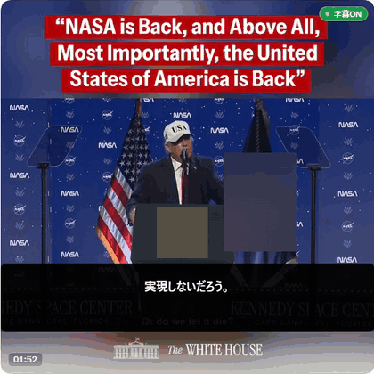

# x-jimaku

[English](README.md) | [日本語](README.ja.md)

x-jimakuは、x.comで再生中の英語動画に日本語字幕を重ねるChrome拡張です。Manifest V3を使い、音声認識と翻訳をブラウザ内で実行します。

Built with PLaMo.

## デモ

[ホワイトハウスが2026年11月7日にXへ投稿した動画](https://x.com/WhiteHouse/status/2118852881684246741)でx-jimakuを動かし、38秒を切り出したものです。音声は入っていません。設定は初期値のまま（Whisper base、PLaMo 0.8B）です。[MP4版](docs/demo/x-jimaku-demo.mp4)もあります。

- 出典はホワイトハウスです。同サイトの[著作権ポリシー](https://www.whitehouse.gov/copyright/)は、政府が作成した素材に著作権の保護はないとしています。
- ホワイトハウスがx-jimakuを推薦しているわけではありません。話者が1人で英語が聞き取りやすいことから選んだ動画で、政治的な立場を示すものではありません。演台と旗にある大統領の紋章はぼかしてあります。
- 日本語字幕は、PLaMo 3 Translateがその場で出した機械翻訳です。公式の翻訳ではなく、誤訳を含みます。字幕の下の小さな英語は、まだ訳していない発話です。

## 機能

- 動画に日本語字幕を重ねます。英語原文も併記できます。
- ツールバーのアイコンかCtrl+Shift+9で開始・停止できます。
- transformers.js経由のWhisperで音声を認識します。tiny、base（既定）、small、turboを選べます。
- 同梱のwllamaを使い、WebGPU上のPLaMo 3 Translateで翻訳します。0.8B（既定）、2B、8Bを選べます。
- 訳し方は「標準」と「やさしい日本語」を選べます。
- 固有名詞・用語の組み込み辞書と、直前の翻訳を文脈に使います。
- PLaMoのキャッシュ一覧で、保存ファイルと容量を確認・削除できます。
- オプションページに「このPCで試す」自己診断と、音声認識の診断表示があります。
- 端末内の字幕表示ログをコピー・ダウンロード・消去できます。

動画要素の`captureStream()`で音声を直接取り出します。オフスクリーンドキュメント内のWhisperで英語を書き起こし、確定した文をPLaMoで日本語に訳します。動画の音声を再生したまま字幕を重ねます。タブ共有の確認画面は出ません。

## 動作要件

Chrome 138以降でWebGPUとGPUアダプターを利用できる必要があります。翻訳にCPUへのフォールバックはありません。Chrome内蔵AIは使いません。

PLaMoのサイズを選ぶ前に、[モデル別の容量と実測値](docs/requirements.ja.md)を確認してください。測定環境はRTX 4070 12GB、Windows 11、Chrome Canary 159の単一構成です。ほかのGPUやOSはここでは動作確認していません。

初回のモデル取得にはインターネット接続と端末の空き容量が必要です。WhisperとPLaMoは別々に取得します。保存済みのファイルは再利用します。

## インストール

配布先は[GitHub Releases](../../releases)のみです。Chromeウェブストア版はありません。

1. Releaseの`x-jimaku-<version>.zip`を取得して展開します。
2. `chrome://extensions`を開きます。
3. デベロッパーモードを有効にします。
4. 「パッケージ化されていない拡張機能を読み込む」で、展開先の`manifest.json`があるフォルダを選びます。zip直下に拡張のファイルがあり、`dist`で包まれてはいません。

## 使い方

1. 拡張のメニューからオプションページを開きます。Whisperモデル、PLaMoのサイズ、訳し方を選びます。設定は次回の字幕開始時に反映します。
2. 字幕を停止した状態で「このPCで試す」を実行します。選んだPLaMoを取得する場合があります。[自己診断で分かること](docs/requirements.ja.md#自分のpcで確認する)も参照してください。
3. x.comで英語動画を再生します。
4. ツールバーのアイコンをクリックするかCtrl+Shift+9を押します。モデル読込中は準備中の表示が出て、開始すると「字幕ON」に変わります。
5. もう一度クリックすると停止します。英語原文の併記や認識結果の確認はオプションページで行います。

## モデルとライセンス

PLaMoはpfnetのGGUFモデルのQ4_K_M量子化版です。初回使用時にhuggingface.coから取得します。取得元のリビジョンを固定し、取得ファイルの容量とSHA-256を使用前に検証します。オプションページでPLaMoのキャッシュ一覧を確認し、全件削除できます。削除後は次回読込時に再取得します。サイズを変更すると、前のPLaMoのキャッシュを置き換えます。

PLaMo 3 Translateは[PLaMo Community License](https://plamo.preferredai.jp/info/plamo-community-license-ja)で提供されます。個人利用とその他の非商用利用は、登録なしで無償です。商用利用は、利用者または関連会社の直近年度の収益または売上高が10億円以下の場合、利用登録後に無償で利用できます。これを超える場合は別途ライセンス契約が必要です。条件はライセンス全文を確認してください。

[Whisper](https://github.com/openai/whisper)はMITライセンスです。拡張はHugging Faceのonnx-communityからONNXモデルを取得し、Apache Licenseのtransformers.jsで動かします。既定はWhisper baseです。モデルの重みは配布zipに含めません。同梱ランタイムなどは[第三者ライセンス表記](THIRD-PARTY-NOTICES.md)を参照してください。

## プライバシー

音声処理、音声認識、翻訳はすべてブラウザ内で実行します。音声・文字起こし・訳文をアップロードしません。拡張はhuggingface.coとhf.co、およびus.aws.cdn.hf.coなどのCDNホストからモデルを取得します。設定はchrome.storage.syncに保存され、Chrome同期が有効な場合はChromeが利用者のGoogleアカウントを通じて同期します。設定に音声や字幕本文は含まれません。アプリのサーバーやテレメトリはありません。

字幕と表示ログは端末内に残ります。表示ログはChromeのローカルストレージを使います。ログのコピーとダウンロードは端末内の操作です。出力したログを共有するかどうかは利用者が判断してください。

## 字幕の表示ログ

記録は**既定で有効**です。配置の数値だけでなく、字幕本文も残ります。

各ページには、折り返した日本語の行、英語原文、まとまりとページの識別子、表示・非表示になった時刻を記録します。オーバーレイが受け取った英文と翻訳段階、待ち行列の負荷で落としたまとまりも記録します。受け取った文の中には、画面に出なかったものも含みます。

直近400ページと400行を保存します。古い記録は捨て、出力には破棄した件数を含めます。字幕の不具合を、発話と実際の表示に照らして調べるための機能です。

オプションページの「表示ログ」で、記録の有効・無効、コピー、ダウンロード、消去を操作できます。無効にしても保存済みの記録は残ります。「表示ログを消す」で保存分を消去します。同じChromeプロファイルを使う人はログを読めます。

## 制限事項

- 英語音声から日本語字幕への翻訳を対象とし、同時に字幕を付ける動画は1本を想定しています。
- 製品全体を通した測定は、既定の0.8Bだけです。2Bと8Bには試作時の実測値がありますが、製品経路での品質と遅延は未測定です。ほかのGPUも未測定です。
- 既定のPLaMoファイルは573,126,848バイトです。別途Whisperも取得します。測定機での試作時の初回読込は、取得込みで63.8秒でした。取得時間は回線によって変わります。[容量表と取得時間の計算例](docs/requirements.ja.md)を参照してください。
- 0.8Bの測定では、台本の文と対応付けできた字幕88ページを合算した、音声内の対応する文の終了から日本語字幕ページが表示されるまでの遅延はp50が2.58秒、p90が4.50秒でした。28ページは対応付けできませんでした。実行ごとのp50は2.0〜4.2秒でした。翻訳だけの実行ごとのp50は0.60〜0.78秒（実行ごとのp50は604〜783ミリ秒）でした。
- 字幕を読み切れない場合があります。同じ測定で、毎秒7文字を超えた日本語字幕はページ数の60％、表示時間の42％でした。毎秒4文字超は72％と58％でした。これは観測値であり、読む速さの目標値ではありません。
- 認識・翻訳の誤り、字幕の遅れや抜けが起こり得ます。WebGPUは必須で、CPUだけで字幕を動かす経路はありません。

## トラブルシューティング

- 読込や翻訳に失敗した場合は字幕を停止し、オプションページの「このPCで試す」を実行してください。WebGPU、アダプター情報、読込エラーを確認できます。モデルがメモリに収まることや、字幕処理が再生に追いつくことを保証する診断ではありません。
- 字幕が止まる、または「音声がありません」と表示される場合は、x.comのタブを前面にして動画の再生状態を確認してください。オプションページの音声レベルと認識結果も確認できます。
- PLaMoを再取得するには、字幕を停止し、オプションページで保存データを削除してから字幕を再開してください。

## ライセンス

拡張のコードは[MIT](LICENSE)です。モデルと同梱の第三者コンポーネントには、それぞれのライセンスが適用されます。上記と[第三者ライセンス表記](THIRD-PARTY-NOTICES.md)を確認してください。
